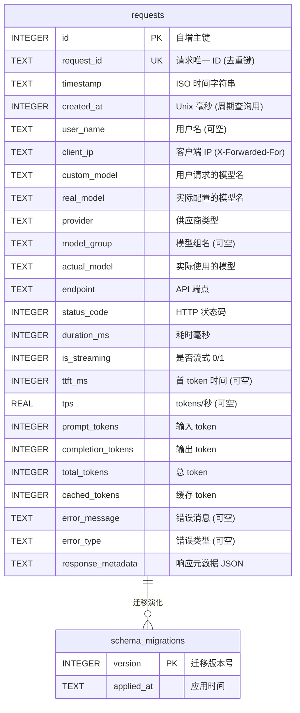

# llm-gatego 数据模型（ER 图）

## SQLite `requests` 表

## 索引

| 索引名 | 列 | 用途 |
|---|---|---|
| `idx_timestamp` | timestamp | 按日期范围查询 |
| `idx_user_name` | user_name | 按用户过滤统计 |
| `idx_client_ip` | client_ip | 按 IP 过滤统计 |
| `idx_custom_model` | custom_model | 按模型聚合用量 / 限流 |
| `idx_created_at` | created_at | 周期限流范围查询（day/week/month/hours） |

## 迁移历史

与原项目 `src/lib/schema.ts` 完全一致：单文件 `0001_create_requests.sql` **一次性建表 24 列 + 5 索引**（含 `client_ip`、`ttft_ms`、`tps`），无增量 ALTER 迁移。

| 版本 | 文件 | 变更 |
|---|---|---|
| 1 | 0001_create_requests.sql | 建表 24 列 + 5 索引（含 client_ip/ttft_ms/tps） |

## 写入语义

- RequestLogger 100ms 批量 flush，按 `request_id` **保留最后一条**（`INSERT ... ON CONFLICT(request_id) DO UPDATE`），对齐原 TS 版 map 去重。
- 流式请求的 TTFT/TPS 在流结束时补写，覆盖早期的不完整条目。
- `CleanupTimer` 每小时删除 `created_at < now - 90d` 的记录。
